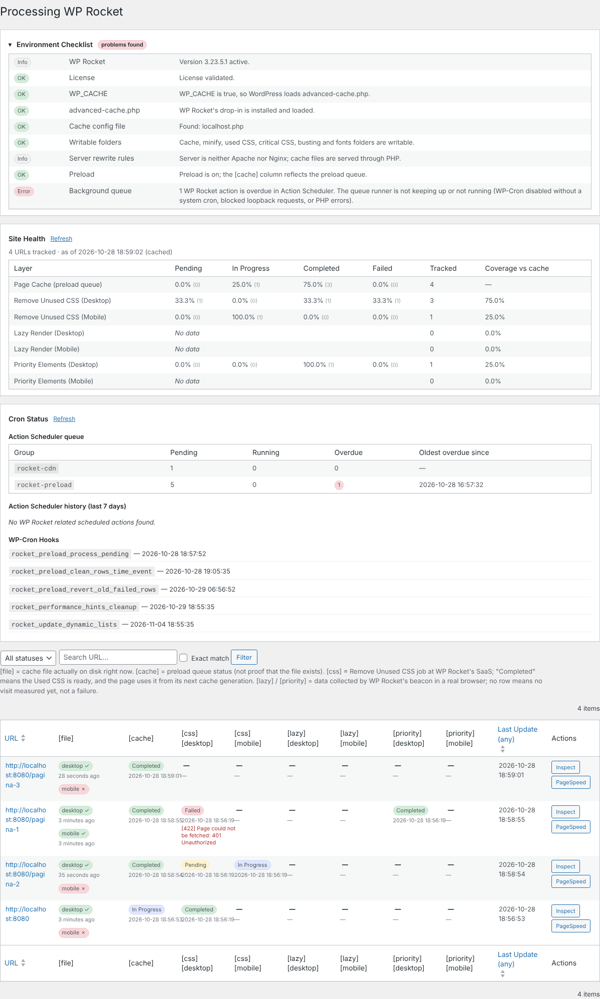
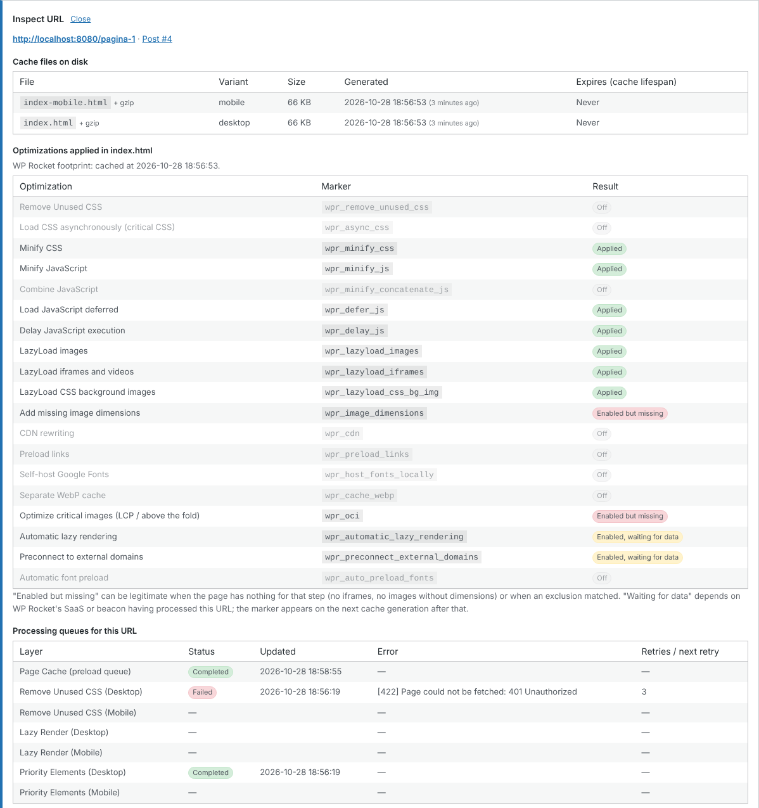

# Processing WP Rocket

  

A diagnostic companion for **WP Rocket** that visualizes processing information from WP Rocket’s internal database tables.

> **Heads‑up:** This is **not** an official WP Rocket plugin. It does not replace or modify WP Rocket behavior; it only **reads and displays** information in the WordPress admin.

---

## ✨ Highlights

- **Environment Checklist**: `WP_CACHE`, WP Rocket's `advanced-cache.php` drop-in, cache config file, writable cache folders, `.htaccess` rules, license, preload and overdue Action Scheduler actions
- **[file] column**: whether the cache file actually exists on disk right now (desktop and mobile) and its age; the `[cache]` column is only the preload queue status
- **Inspect URL**: cache files on disk, the optimizations WP Rocket actually applied to the page (read from its `data-wpr-features` meta tag) compared with the enabled settings, per-post exclusions, and error details for each queue
- **Error messages** from WP Rocket's tables (e.g. Remove Unused CSS SaaS errors) under each failed status
- **Unified table view** with search and filters, including an **exact match** toggle for finding a single URL (e.g. the home page) without substring noise
- **Site Health panel** at the top of the screen showing the percentage of URLs Pending/In Progress/Completed/Failed for each layer (cache, RUCSS, lazy render, priority elements)
- **Cron Status panel** showing the Action Scheduler backlog per group (pending, running, overdue), Action Scheduler history per hook (last 7 days) and WP Rocket's native WP-Cron hooks (next run, overdue flag)
- **Status badges** (Pending, In Progress, Completed, Failed) with colors  
- **Status + date** in the same cell (date adjusted to your **WordPress timezone**)  
- **Cache status unified** (no desktop/mobile split)  
- **PageSpeed Insights** button for each URL  
- **i18n-ready** (English default) and **pt_BR** translation included

---

## 🔎 What it reads

From WP Rocket tables (auto‑detected):
- `wpr_rocket_cache`
- `wpr_rucss_used_css`
- `wpr_lazy_render_content`
- `wpr_above_the_fold`

The plugin shows one row per URL with the per‑layer status (cache, Used CSS, lazy, priority elements). It also reads, without changing anything:
- the cache files in `wp-content/cache/wp-rocket/` (existence, age, and the `data-wpr-features` meta tag WP Rocket writes into each cached page);
- `wp-content/advanced-cache.php`, `wp-content/wp-rocket-config/` and `.htaccess` for the environment checklist;
- `{prefix}actionscheduler_actions` for the queue backlog and history.

### What each column means

| Column | Meaning |
| --- | --- |
| `[file]` | The cache file exists on disk right now (desktop/mobile) and how old it is. |
| `[cache]` | Status of the URL in WP Rocket's **preload queue**. Not proof that the file exists. Only updated while preload is on. |
| `[css]` | Remove Unused CSS job at WP Rocket's SaaS (`to-submit` → pending, `in-progress`, `completed`, `failed`). "Completed" means the Used CSS is ready; the page uses it from its next cache generation. |
| `[lazy]` / `[priority]` | Data collected by WP Rocket's beacon in a real browser (Lazy Render Content, LCP / above the fold). No row = no visit measured yet. |

---

## ✅ Requirements

- WordPress **6.0+**
- PHP **7.4+**
- **WP Rocket** active (for data to be available)

---

## 📦 Installation

1. Download the plugin ZIP from the releases or build it locally.  
2. In **WordPress Admin → Plugins → Add New → Upload Plugin**, upload the ZIP.  
3. Activate. You’ll see **Processing WP Rocket** in the admin menu.

---

## 🧭 Usage

1. Keep **WP Rocket** active.  
2. Go to **Tools → Processing WP Rocket**.  
3. Check the **Environment Checklist** first; it opens automatically when something needs attention.  
4. Browse the table: each cell shows **status** (color), **last update date** and, when there is one, the **error message**.  
5. Click **Inspect** on a row to see the cache files and which optimizations were actually applied to that page.  
6. Use the **PageSpeed** button to open a quick test for the URL.

> Notes
> - The plugin **does not** clear caches or change WP Rocket settings. Since 2.2.0 it contains no purge code at all.  
> - Pagination and filters run in SQL, so the screen stays fast on large sites.

---

## 🌐 Internationalization

- Default strings in **English**.  
- Included translation: **Português (Brasil)** `pt_BR`.  
- Text domain: `processing-wp-rocket`.  
- WordPress will load the translation automatically according to **Settings → General → Site Language**.

---

## 🧩 Developer Notes

- Admin table built with `WP_List_Table`.  
- Dates rendered with `wp_date()` and `wp_timezone()` to respect the site timezone.  
- Status normalization maps common synonyms to: `pending`, `in_progress`, `completed`, `failed`.

### Filters

- `pwr_status_labels` — customize status labels displayed on badges.  
- `pwr_datetime_format` — change date format (default `Y-m-d H:i:s`).  
- `pwr_tables` — override/extend which WP Rocket tables are scanned.  
- `pwr_min_capability` — adjust capability needed to access the screen (default `manage_options`).
- `pwr_table_per_page` — rows per page in the admin list table (default `20`).
- `pwr_repository_items` — short-circuit the table scan entirely with custom `items`/`total` data (list table only; the Site Health panel always reads the tables live).
- `pwr_health_cache_ttl` — cache lifetime in seconds for the Site Health panel (default `5 * MINUTE_IN_SECONDS`).
- `pwr_health_field_labels` — customize the per-layer labels shown in the Site Health panel.
- `pwr_cron_cache_ttl` — cache lifetime in seconds for the Cron Status panel (default `5 * MINUTE_IN_SECONDS`).
- `pwr_cron_hook_pattern` — substring used to auto-detect WP Rocket's cron hooks and Action Scheduler actions (default `rocket`).
- `pwr_cron_window_days` — how many days of Action Scheduler history to aggregate per hook (default `7`).
- `pwr_cron_past_due_grace` — seconds after its scheduled time before a pending Action Scheduler action counts as overdue (default `10 * MINUTE_IN_SECONDS`).
- `pwr_inspect_max_bytes` — maximum bytes read from a cache file when inspecting a URL (default `8 * MB_IN_BYTES`).

---

## 🖼 Visualization example

> Environment checklist, site health with coverage, queue status and the per-URL table with the `[file]` column and error messages.

> Inspect URL: cache files on disk, optimizations applied vs enabled, and the processing queues for that URL.

---

## 🚀 Changelog (excerpt)

### 2.2.0
- Added an **Environment Checklist**, a **[file]** column, an **Inspect URL** panel and **error messages** from WP Rocket's tables.
- Added the **Action Scheduler backlog** (pending / running / overdue per group) and **coverage vs cache** in Site Health.
- Fixed status filtering and badges for WP Rocket's raw `in-progress` / `to-submit` values, status conflict resolution, and exact-match search with a trailing slash.
- Moved pagination, sorting and filtering to SQL.
- Removed the legacy REST purge endpoints (the RUCSS path could wipe the Used CSS of the whole site).

### 2.1.0
- Added an **exact match** search toggle, for finding a single URL (e.g. the home page) without substring noise.
- Added a **Site Health** panel with per-layer status percentages across the whole site.
- Added a **Cron Status** panel combining native WP-Cron and Action Scheduler data specific to WP Rocket.

### 2.0.0
- Unified **cache** status (no desktop/mobile).  
- Timezone‑aware date rendering.  
- i18n support with **pt_BR** translation.  
- Removed purge/clear buttons; kept only **PageSpeed**.  
- UI cleanup & stability improvements.

### 1.0.0
- Initial release with admin table of WP Rocket processing info.

Full changelog lives in [`readme.txt`](./readme.txt) (WordPress.org format).

---

## 📄 License

GNU General Public License v2.0 or later. See [`LICENSE`](./LICENSE) or the header in the main plugin file.
